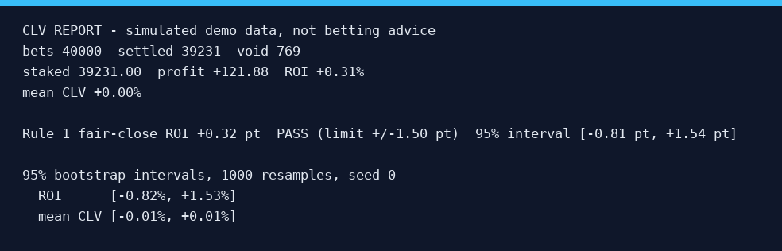

# demo-clv-report

A Python 3.12 CLI that turns a CSV of placed bets into an honest closing-line-value report:
no-vig fair closing prices, per-bet CLV, ROI with a seeded bootstrap interval, and a Rule 1
calibration check on the closing market.



## What it shows

- **No-vig fair closing price** per bet (proportional method) and **CLV** = `taken_odds *
  fair_close_prob - 1`, so a bet that beat the close shows up positive.
- **Totals**: number of bets, settled bets, staked, profit, ROI and mean CLV over settled bets.
- **Seeded percentile bootstrap** 95% intervals for ROI, mean CLV and fair-close ROI (`--seed`,
  `--resamples`, default 10,000 resamples).
- **Rule 1 calibration check**: the ROI the same bets would have returned at the fair closing
  price, printed with its interval and PASS / FAIL / INCONCLUSIVE against a 1.5 point band.
- **Honest small-sample behaviour**: below 30 settled bets it prints `not enough data (N bets,
  need 30)` instead of intervals and verdicts.

## Quick start

```bash
python -m clvreport simulate --n 40000 --seed 1 --out sim.csv
python -m clvreport report sim.csv --seed 0 --resamples 1000
python -m clvreport report sim.csv --csv out.csv --json --seed 1 --resamples 2000
```

`simulate` writes a simulated bets CSV (`--edge 0.03` injects a true 3% edge, default `0` is a
calibrated closing market). `report` reads a CSV with the columns `date, event, selection,
taken_odds, closing_odds, closing_odds_other, result, stake`; `closing_odds_other` holds the other
side(s) of the market, `;`-separated for a 3-way market.

## Example report

Output of `python -m clvreport simulate --n 40000 --seed 1 --out sim.csv` followed by
`python -m clvreport report sim.csv --seed 0 --resamples 1000`: 40,000 simulated bets,
39,231 settled, with 1,000 bootstrap resamples. This larger sample makes the calibration interval
precise enough for PASS; 500 bets with seed 1 give INCONCLUSIVE. `python docs/render_preview.py`
regenerates this example and its preview with the same sample and bootstrap settings:

```text
CLV REPORT - simulated demo data, not betting advice
bets 40000  settled 39231  void 769
staked 39231.00  profit +121.88  ROI +0.31%
mean CLV +0.00%

Rule 1 fair-close ROI +0.32 pt  PASS (limit +/-1.50 pt)  95% interval [-0.81 pt, +1.54 pt]

95% bootstrap intervals, 1000 resamples, seed 0
  ROI      [-0.82%, +1.53%]
  mean CLV [-0.01%, +0.01%]
```

## Method notes

- **No-vig closing probability** (`clvreport/odds.py`): every side's implied probability `1/odds`
  is divided by the market overround, so the fair probabilities sum to 1. This is the proportional
  (normalised) method; it assumes the margin is spread across the market in proportion to price.
- **CLV**: `taken_odds * fair_close_prob - 1`, per unit staked. Positive means the price taken was
  better than the fair closing price.
- **Bootstrap** (`clvreport/bootstrap.py`): settled bets are resampled with replacement, using the
  same sampled rows for ROI, mean CLV and fair-close ROI. Each ROI divides total sampled profit by
  total sampled stake. Intervals use the 2.5th-97.5th percentiles; a fixed seed reproduces a run.
- **Rule 1**: a calibrated closing market has expected fair-close ROI zero. PASS requires both a
  realised ROI within +/-1.5 points and a 95% interval half-width at most 1.5 points. FAIL requires
  the entire interval strictly above +1.5 or below -1.5 points. All other cases are INCONCLUSIVE:
  more bets are needed because the interval is too wide or still overlaps the limit. The half-width
  is half the distance between the interval endpoints. JSON includes the same verdict, interval,
  half-width and explanation; `rule1.pass` is `null` for INCONCLUSIVE.
- **30-bet floor**: with fewer than 30 settled bets the bootstrap intervals and the Rule 1 verdict
  are not printed at all, because at that size they only measure noise.
- **Void bets** are kept in the per-bet CSV but excluded from settled counts, staked, profit, ROI,
  mean CLV and Rule 1.
- **Noise, stated plainly**: a few hundred calibrated bets can land outside +/-1.5 points by chance.
  The interval keeps a noisy point estimate from being labelled FAIL on its own. Bootstrap
  intervals describe sampling variation; PASS is evidence under this rule, not proof of calibration.

## Honesty

Original demo, simulated data only, not client work, AI-assisted. Analysis only: it never places
bets and gives no betting advice. No real bookmaker data is included; events are named
`Event 001`-style.

## Development

```bash
python -m unittest discover -s tests
python -m ruff check .
python docs/render_preview.py   # regenerates docs/preview.png and the example above (Pillow)
```

Runtime code uses the standard library only; Pillow and ruff are dev dependencies.
